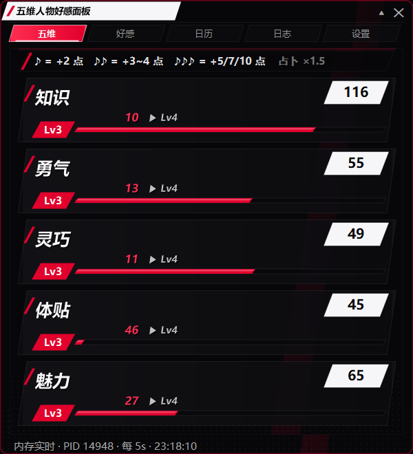
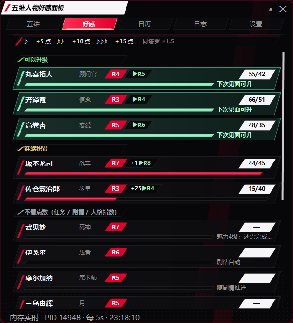
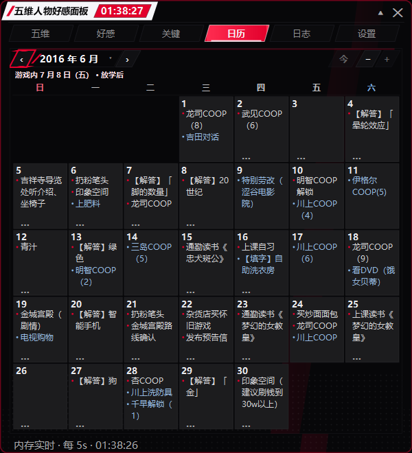
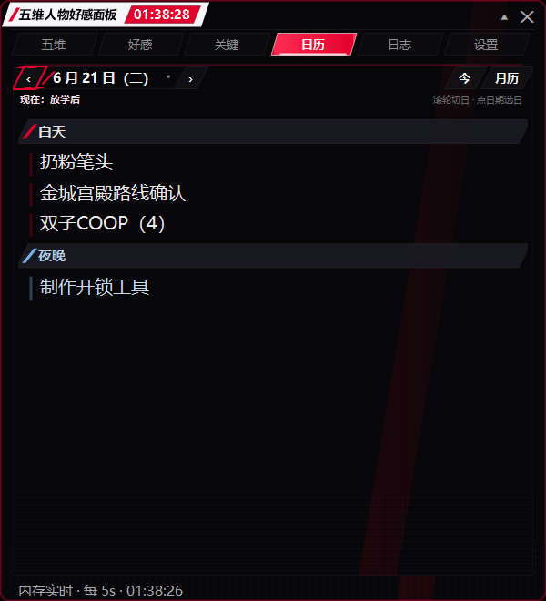
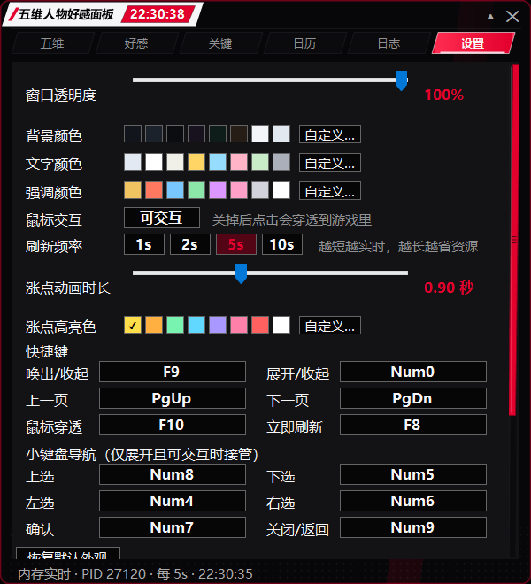
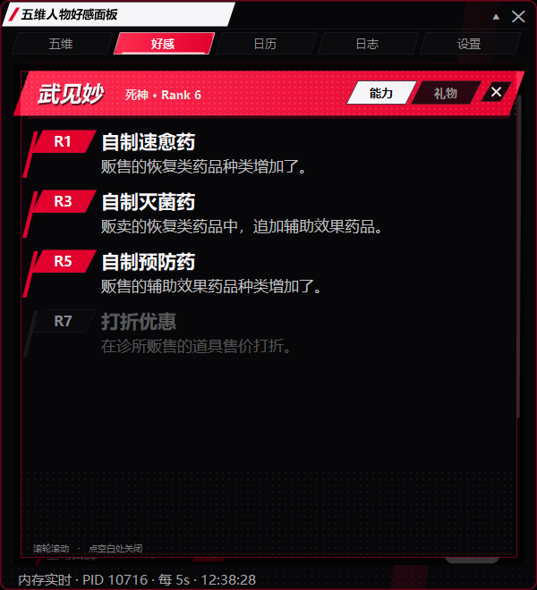
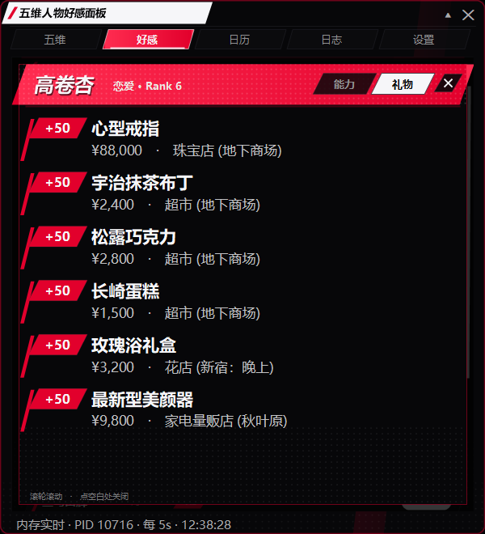

# P5R 五维人物好感面板 · P5R Stats Overlay

《女神异闻录5 皇家版》PC 版的实时状态悬浮面板：**五维**（知识 / 勇气 / 灵巧 / 体贴 / 魅力）
与 **Coop 羁绊**（Rank、好感点数、距下一级还差多少），全部直接读运行中游戏的内存，
不用装 Mod、不用重启游戏。游戏没开时自动读最新存档，显示最后一次保存时的状态。

[](https://www.bilibili.com/video/BV1RXsU6tEdy/)

> **演示视频**：[《P5RMod 揭露正确选项、五维和人物好感度》](https://www.bilibili.com/video/BV1RXsU6tEdy/) · 8 分 53 秒 · Bilibili（点封面直接播放）

界面按 P5R 的饰品菜单风格做的：斜切色块、平行四边形数值标签、红色 Lv 徽章、硬边黑红白配色，
可收起成一条横条、鼠标穿透、全局快捷键、配色主题、托盘常驻。

> **配套项目**：[P5R-Dialogue-Annotation](https://github.com/BHSY-wc/P5R-Dialogue-Annotation)
> —— 对话选项标注 Mod（♡恋人 ／ ◆友人 ／ ↑好感最优 ／ ★正确答案）。装上它游戏里直接标出该选哪个，
> 这个面板负责看数值，两个一起用最舒服。

| 五维 | 好感 |
|---|---|
|  |  |

| 日历（展开：每格带当天安排，文字自动换行） | 日视图（点 `今` 整页看当天） |
|---|---|
|  |  |

| 设置 | 收起态 |
|---|---|
|  |  |

| 点角色 → 能力（各级解锁什么） | 同一个弹层 → 礼物（好感 +50 送什么） |
|---|---|
|  |  |

---

## 特性

- **实时**：默认 5 秒轮询，读内存只读不写，不碰存档
- **存档兜底**：游戏关着时读最新存档（AES-256 解密后按固定偏移解析）
- **五页面**：五维 / 好感 / 日历 / 日志 / 设置
- **四种分组**：好感按「可以升级 / 继续积累 / 不看点数 / 已满级」自动归类
- **点开看攻略**：点任意好感行，看该角色 Rank 2~10 各级解锁的能力（已解锁红、未解锁灰、二觉三觉标「剧情」）；
  弹层右上角还能切到 **礼物** 页，直接列出该角色**好感 +50** 的礼物、价格和购买店铺（字号与能力页一致）
- **恋爱线别选错**：10 个可攻略角色的关键对话选项按 Rank 插在能力表里，**粉红爱心**标出；
  浅粉＝恋人前置条件、深粉＝最后确认项（选错就永久走友人线，Rank 10 约会事件消失）
- **日历**：读游戏内日期（几月几日 + 白/夜），把《一周目完美日程》当天该做的事摊在月历上；格子里的条目自动换行，可左右翻月、点年月跳月份、`−/＋` 切换「只看日期 / 显示事项」，点日期看大号详情，`今` 整页切到当天的日程（`‹ ›` 切日、点日期选任意一天、`月历` 返回）
  日历有独立的 **10 秒心跳**：游戏里过日子后自己翻到新的一天（跨月也跟），不用手点 `今`；手动翻走则显示「已暂停跟随」，不抢你的视图
  点任意五维项，看这一级放开了哪些被卡住的 Coop 门槛（如勇气 2 级开武见妙）
- **可调**：不透明度、背景/文字/强调色（各 8 预设 + 自定义）、刷新频率、六个快捷键
- **穿透**：`F10` 让面板变贴图，点击直接落到游戏里
- **高 DPI**：PerMonitorV2 + GDI ClearType，不做位图缩放
- **自适应**：换存档、多周目、游戏重启都会自动重新定位，不用重开面板

## 快速开始

> 详细步骤（运行时下载页、SmartScreen 拦截怎么点、权限不一致怎么处理、装不上怎么排错）见 **[docs/安装教程.md](docs/安装教程.md)**。

1. 装 **.NET 8 桌面运行时**（Desktop Runtime，x64）
2. 下载 Release 里的 zip，解压
3. 双击 `P5ROverlay.exe`
4. 收起态下按 `Num0` 展开

需要 P5R PC **1.0.4**。窗口化游戏，独占全屏下悬浮窗不显示。

## 怎么读出来的

技术细节见 **[docs/读取解析方法说明.md](docs/读取解析方法说明.md)**，要点：

| 数据 | 方式 |
|---|---|
| 五维 | exe 内扫签名 `4C 8D 35 ?? ?? ?? ?? 0F B7 FD`，按 RIP 相对寻址算出 `short[5]` 地址 |
| Coop | 在五维地址前 `0x600` 字节内逐字节试起点，按 16 字节步长 + 白名单校验推出数组起点（不写死偏移） |
| 存档 | `%APPDATA%\SEGA\P5R\Steam\*\savedata\DATAxx\DATA.DAT`，AES-256-CBC 解密后解第二段 zlib |

> ⚠️ 五维数组顺序是 `[知识, 魅力, 灵巧, 勇气, 体贴]`，**和游戏菜单显示顺序不同**。
> 早期版本按菜单顺序硬套，导致「涨魅力、面板涨体贴」，判定依据与修正过程写在文档第 2.6 节。

## 目录

```
src/P5ROverlay/      C# 源码（.NET 8 / WinForms / x64）
  Core/              进程附加、签名扫描、Coop 定址、存档解密、数据表
  UI/                窗口、四页绘制、P5R 风格绘制原语
  Assets/            图标源图 + app.ico + 生成脚本
docs/                安装教程 / 使用说明 / 读取解析方法说明 / Coop 需求表 / 截图
tools/               早期 Python 版（终端面板 + 存档批量查看）
```

## 编译

```bash
cd src/P5ROverlay
dotnet build -c Release      # 输出到 src/P5RPanel/（csproj 里写的是 ..\P5RPanel\）
```

自检（游戏可以不开）：

```bash
P5ROverlay.exe --test    # 只读不画窗，结果写 selftest.txt
P5ROverlay.exe --shot    # 四页各截一张到 shots\，无游戏时灌演示数据
```

## 数据来源

- Coop ID 表：Amicitia Wiki 的 `Confidant` 枚举
- 每级好感需求：bilibili 游戏 Wiki 各 COOP 页「触发条件」栏，其中「星·东乡一二三」一行与
  《P5R 官方完全攻略本》第 39 页一致
- 音符换算：Megami Tensei Wiki / Social Stats、游民星空《属性值提升指南》
- 日历日程：B 站「一位话家」《P5R 一周目最高难度完美日程》表（310 天 / 676 条），已随面板分发；
  日期与时段从游戏内存读取（存档里同一结构做兜底）
- 礼物列表：bilibili 游戏 Wiki《P5R/赠礼指南》礼物 × 角色矩阵，只取「好感 +50」最高档
- 恋爱线选项：bilibili 游戏 Wiki《P5R/十艘跳指南》+ 各角色 COOP 对话页（2026-11），
  只收「选错就进不了恋人线」的关键选项

## 声明

本项目不含任何游戏资源文件，不联网、不上传，仅读取本机进程内存与存档文件。
请自行拥有正版游戏，与 ATLUS / SEGA 无关。

## 许可

[MIT](LICENSE)
